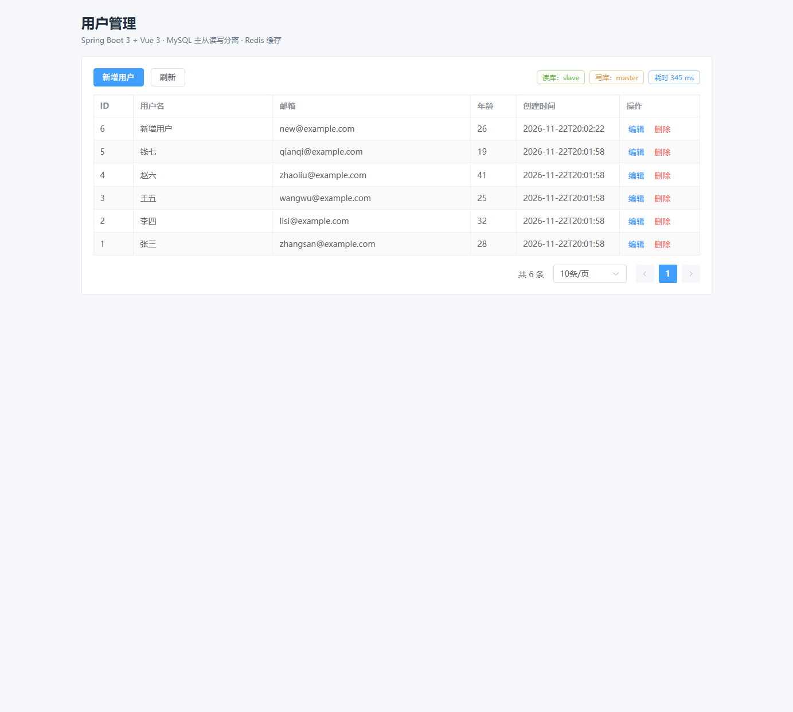

# Spring Boot + Vue3 前后端分离示例（MySQL 读写分离 + Redis 缓存）

一个可以直接 `docker compose up` 跑起来的前后端分离小项目，重点演示三件事：

1. **前后端彻底分离**：Vue3 只管渲染和调接口，Spring Boot 只提供 JSON API，前端由 Nginx 托管并反向代理 `/api`。
2. **MySQL 读写分离**：写操作走主库，查询走从库，用 `dynamic-datasource` + `@DS` 注解实现，主从之间用 binlog 原生复制。
3. **Redis 做缓存**：查询结果缓存到 Redis，写操作后自动失效（`@Cacheable` / `@CacheEvict`）。

页面上会直接显示"这次查询走的是哪个库""耗时多少毫秒"，方便肉眼确认读写分离和缓存是否真的生效。



---

## 一、技术栈

| 层 | 技术 |
|---|---|
| 后端 | Spring Boot 3.2.5 / Java 17 / MyBatis-Plus 3.5.5 |
| 读写分离 | dynamic-datasource-spring-boot3-starter 4.3.0 |
| 缓存 | Spring Cache + Redis（`RedisCacheManager` + JSON 序列化） |
| 数据库 | MySQL 8.0（主库 + 从库，binlog ROW 格式复制） |
| 前端 | Vue 3 + Vite 5 + Element Plus + axios |
| 部署 | Docker / docker compose（镜像内完成前后端构建） |

---

## 二、架构与请求流向

```
浏览器
  │  http://localhost:8095
  ▼
demo-frontend (Nginx :80)
  ├── /          → Vue3 打包后的静态文件
  └── /api/*     → proxy_pass 到 http://backend:8080
                        │
                        ▼
              demo-backend (Spring Boot :8080)
                        │
        ┌───────────────┼────────────────┐
        │ 写方法（默认）  │ 读方法 @DS("slave") │  缓存
        ▼               ▼                ▼
   mysql-master    mysql-slave        redis
    :3306 写        :3306 读          :6379 缓存
        │               ▲
        └── binlog 复制 ─┘
```

一次"查列表"的完整链路：

1. 浏览器请求 `GET /api/users?page=1&size=10`，打到 Nginx。
2. Nginx 把 `/api` 前缀转发给后端容器 `backend:8080`。
3. 后端 `UserController` 调 `UserService.page()`。
4. 先查 Redis，命中就直接返回（`elapsed` 只有几十毫秒）。
5. 未命中 → `@DS("slave")` 把数据源切到从库，执行分页 SQL。
6. 结果写入 Redis（key 形如 `user:page::p1:s10`），返回给前端。

一次"新增用户"的链路：

1. `POST /api/users` → `UserService.save()`，没有 `@DS`，走 `primary=master`。
2. 写主库成功后，`@CacheEvict(allEntries = true)` 清空 `user:*` 缓存。
3. 主库的 binlog 被从库的复制线程拉走并重放，从库几百毫秒内出现新数据。
4. 下一次查询重新走从库、重建缓存。

---

## 三、目录结构

```
springboot-vue-demo/
├── backend/                     # Spring Boot 后端
│   ├── pom.xml
│   ├── maven-settings.xml       # Maven 国内镜像（随镜像一起构建，换机器也能快速拉依赖）
│   ├── Dockerfile               # 多阶段构建：maven 编译 → jre 运行
│   └── src/main/
│       ├── java/com/demo/
│       │   ├── DemoApplication.java
│       │   ├── common/Result.java              # 统一返回体
│       │   ├── config/MybatisPlusConfig.java   # 分页插件
│       │   ├── config/RedisConfig.java         # 缓存序列化、TTL
│       │   ├── config/WebConfig.java           # CORS
│       │   ├── controller/UserController.java  # 接口 + 耗时统计
│       │   ├── entity/User.java
│       │   ├── mapper/UserMapper.java
│       │   └── service/UserService.java        # @DS / @Cacheable / @CacheEvict 都在这里
│       └── resources/application.yml
├── frontend/                    # Vue3 前端
│   ├── Dockerfile               # node 构建 → nginx 托管
│   ├── nginx.conf               # 静态资源 + /api 反向代理
│   ├── vite.config.js
│   └── src/
│       ├── main.js
│       ├── App.vue
│       ├── api/request.js       # axios 实例
│       ├── api/user.js
│       └── views/UserList.vue   # 表格 + 新增/编辑/删除 + 数据源提示
├── docker/mysql/
│   ├── master/init.sql          # 建库建表、种子数据、复制账号、应用账号
│   └── slave/init.sh            # 从库建立复制关系
├── docker-compose.yml
└── README.md
```

---

## 四、快速开始

前置：装好 Docker 和 docker compose（Windows 上 Docker Desktop + WSL2 也可以）。

```bash
git clone https://github.com/R1ceShower0929/springboot-vue-demo.git
cd springboot-vue-demo
docker compose up -d --build
```

首次构建要拉 Maven / npm 依赖，大约 3～6 分钟；之后启动只要十几秒。

打开 <http://localhost:8095> 就是完整页面。

### 端口分配

| 端口 | 用途 |
|---|---|
| 8095 | 前端页面（Nginx） |
| 8090 | 后端 API（Spring Boot） |
| 3306 | MySQL 主库（写） |
| 3307 | MySQL 从库（只读，映射容器内 3306） |
| 6379 | Redis |

> 主从两个库都是同一个 `demo` 库，账号密码：应用账号 `demo / demo123456`（无 SUPER 权限），管理账号 `root / root123456`。

### 停止与清理

```bash
docker compose down          # 停止容器，保留数据
docker compose down -v       # 连数据一起清掉，下次启动会重新初始化主从
```

---

## 五、接口一览

| 方法 | 路径 | 说明 | 走哪个库 |
|---|---|---|---|
| GET | `/api/users?page=1&size=10` | 分页查询，返回 `total`、`datasource`、`elapsedMs` | 从库（并缓存） |
| GET | `/api/users/{id}` | 按 id 查询 | 从库（并缓存） |
| POST | `/api/users` | 新增 | 主库（清缓存） |
| PUT | `/api/users/{id}` | 修改 | 主库（清缓存） |
| DELETE | `/api/users/{id}` | 逻辑删除 | 主库（清缓存） |
| GET | `/api/users/ping/datasource` | 打印当前读/写数据源 | — |

统一返回体：

```json
{ "code": 0, "message": "success", "data": { ... } }
```

---

## 六、怎么验证读写分离和缓存真的生效

启动完成后按顺序敲下面几条（Windows PowerShell 里把 `curl` 换成 `curl.exe`）：

```bash
# 1) 当前读写数据源
curl http://localhost:8090/api/users/ping/datasource
# {"code":0,"message":"success","data":{"readDatasource":"slave","writeDatasource":"master"}}

# 2) 第一次查询：走从库 + 回源，耗时较长
curl "http://localhost:8090/api/users?page=1&size=10"
# data.datasource=slave, data.elapsedMs ≈ 300ms

# 3) 第二次同样的查询：命中 Redis，耗时骤降
curl "http://localhost:8090/api/users?page=1&size=10"
# data.elapsedMs ≈ 20ms

# 4) 写一个用户：走主库，并清缓存
curl -X POST http://localhost:8090/api/users \
  -H "Content-Type: application/json" \
  -d '{"username":"新增用户","email":"new@example.com","age":26}'

# 5) 缓存已经被清掉（输出 0 条）
docker exec demo-redis redis-cli --scan --pattern 'user:*' | wc -l

# 6) 从库几秒内同步到新数据
docker exec demo-mysql-slave mysql -uroot -proot123456 -N -e "USE demo; SELECT COUNT(*) FROM t_user;"

# 7) 应用账号往从库写，会被只读拦下来
docker exec demo-mysql-slave mysql -udemo -pdemo123456 \
  -e "USE demo; INSERT INTO t_user(username,email,age,deleted) VALUES('bad','b@b.com',1,0);"
# ERROR 1290 (HY000): The MySQL server is running with the --read-only option ...
```

本机实测结果（供对照）：

```
ping        → readDatasource=slave, writeDatasource=master
1st GET     → total=5, ds=slave, elapsed=317ms
2nd GET     → total=5, ds=slave, elapsed=25ms     ← 缓存生效
POST        → id=6, name=新增用户
redis keys  → 0 个（写后缓存被清空）
slave count → 3 秒内从 5 变成 6               ← 复制生效
从库直接写  → ERROR 1290（被只读拦住）
前端页面    → <title>用户管理 · Spring Boot + Vue3</title>
Nginx 代理  → /api/users 返回真实数据
```

---

## 七、关键实现说明

### 1. 读写分离怎么做的

`application.yml` 里注册两个数据源，`primary: master`：

```yaml
spring:
  datasource:
    dynamic:
      primary: master
      datasource:
        master: { url: jdbc:mysql://mysql-master:3306/demo ... }
        slave:  { url: jdbc:mysql://mysql-slave:3306/demo  ... }
```

`UserService` 里只给读方法加注解，写方法不加（默认 master）：

```java
@DS("slave")                 // 这一句把本次执行的连接切到从库
@Cacheable(cacheNames = "user", key = "'page::p' + #page + ':s' + #size")
public Page<User> page(long page, long size) { ... }

@CacheEvict(cacheNames = "user", allEntries = true)
public boolean save(User user) { ... }   // 没有 @DS，走 master
```

`@DS` 是靠 AOP 在方法执行前把数据源标识压进 `DynamicDataSourceContextHolder`，方法结束再清掉；`Page` 返回里带 `DynamicDataSourceContextHolder.peek()`，所以页面上能看到这次到底走的哪个库。

### 2. 缓存怎么做的

`RedisConfig` 自定义 `RedisCacheManager`：value 用 JSON 序列化（`redis-cli` 里能直接看懂）、默认 TTL 10 分钟、key 前缀 `user:`。写方法用 `@CacheEvict(allEntries = true)` 整体失效，避免按 id 精确删除时漏掉分页缓存。

### 3. 主从复制怎么搭的

- 主库启动参数：`--server-id=1 --log-bin=mysql-bin --binlog-format=ROW`
- 从库启动参数：`--server-id=2 --read-only=ON`，容器第一次启动时由 `docker/mysql/slave/init.sh` 执行 `CHANGE REPLICATION SOURCE TO` + `START REPLICA`。
- 复制账号 `repl / repl123456` 只授 `REPLICATION SLAVE`、`REPLICATION CLIENT`。

### 4. 从库为什么能拦住写

只读从库有两道关，缺一不可：

- `--read-only=ON`：普通账号（无 SUPER）写入直接报 `ERROR 1290`。
- 应用账号 `demo` 只授了 `demo.*` 上的 CURD，**没有 SUPER**。root 有 SUPER 能绕过 `read_only`，所以应用绝对不能用 root 连从库。

---

## 八、踩过的坑（都是真实踩到的）

1. **从库只同步到一半数据**：`CHANGE REPLICATION SOURCE TO` 不指定 `SOURCE_LOG_FILE / SOURCE_LOG_POS` 时，默认从"当前 binlog 末尾"开始，初始化阶段建的库、表、种子数据永远同步不过来。必须取最早 binlog 文件 + `POS=4` 从头重放。
2. **`SET GLOBAL read_only` 重启就没了**：MySQL 官方镜像初始化阶段跑的是临时 server，脚本里的 `SET GLOBAL` 不会写进配置文件，正式 server 一起来就恢复原值。只读必须在启动参数或配置文件里给。
3. **挂在 Windows 文件系统上的 `.cnf` 被忽略**：`/mnt/c` 下的文件是 777，mysqld 会打印 `World-writable config file ... is ignored`。要么改权限，要么改用命令行参数。
4. **中文种子数据变乱码**：初始化 SQL 没声明字符集时，中文会被按 latin1 存成双重编码（`张三` 存成 `C3A5C2BCC3A5...`）。在 `init.sql` 里 `SET NAMES utf8mb4` 即可。
5. **8080 / 8081 端口被占**：本机 Jenkins 占了 8080，8081 也绑不上，所以后端用 8090、前端用 8095。
6. **容器启动顺序**：后端比 MySQL 先起来会 `Connection refused` 然后反复重启。用 `depends_on` + `healthcheck` 解决，并给所有服务加 `restart: unless-stopped`。

---

## 九、上生产的差距

这个项目是为了把原理讲清楚，真上生产还需要补：

- 数据库账号、Redis 密码走密钥管理，不进代码库
- MySQL 用 GTID 复制 + 自动故障切换（如 Orchestrator / MHA），而不是手工 `CHANGE REPLICATION`
- 缓存要处理穿透/击穿/雪崩（布隆过滤器、空值缓存、随机 TTL）
- Nginx 加 HTTPS、gzip、静态资源长缓存
- 后端加链路追踪、健康检查探针、限流熔断
- CI/CD 走 Jenkins/GitHub Actions 构建镜像 → 推送 Harbor → 由 Argo CD 部署到 K8s