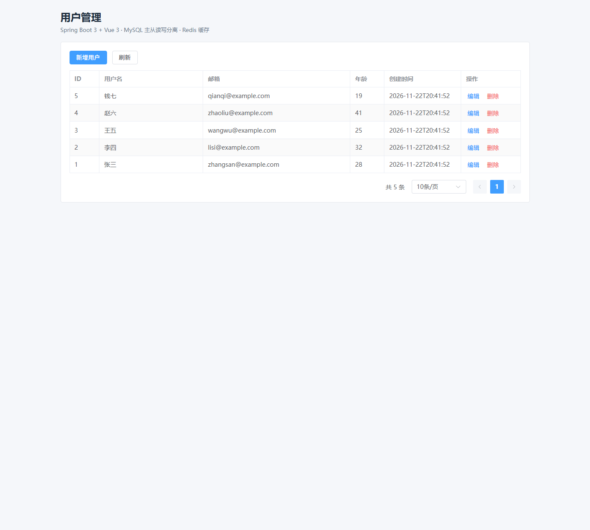

# springboot-demo 的 CI/CD 全链路说明

> 对象：本项目（Spring Boot 3 + Vue3 + MySQL 主从读写分离 + Redis 缓存）
> 流水线：GitHub → Jenkins → Harbor → 部署仓库（GitOps）→ Argo CD → Kubernetes
> 环境：Windows 宿主 + WSL2 Ubuntu（Docker Engine + kubeadm 单节点 k8s v1.33.13）
> 本文所有数字与状态均来自本次真实执行记录，可直接据此复跑。

---

## 1. 这套环境长什么样

```
Windows 宿主
└─ WSL2 Ubuntu（Docker Engine + 单节点 kubeadm 集群都跑在这里）
   ├─ Jenkins 容器  (8080)   ← 挂载宿主 /var/run/docker.sock
   ├─ Harbor 容器栈 (443 / UI 8082, 域名 harbor.local)
   ├─ Argo CD       (30090)
   └─ k8s 控制面 desktop-pcm1i82
      └─ namespace demo：mysql-master / mysql-slave / redis / backend / frontend
         └─ frontend Service NodePort 30095
            └─ socat 转发容器 30096 → 让 Windows 浏览器能访问
```

| 角色 | 组件 | 地址 / 账号 | 职责 |
|---|---|---|---|
| 源码 | GitHub `R1ceShower0929/springboot-demo` | main 分支 | 应用代码 |
| 构建 | Jenkins `springboot-demo-ci` | `http://localhost:8080` | 编译、打镜像、推镜像、改部署清单 |
| 镜像仓库 | Harbor 项目 `demo` | `https://harbor.local`，UI `http://localhost:8082`，`admin` / `Harbor@2026` | 存放不可变版本镜像 |
| 部署清单仓库 | GitHub `R1ceShower0929/springboot-demo-deploy` | `k8s/app.yaml` | 集群"期望状态"的唯一来源 |
| 发布 | Argo CD 应用 `springboot-demo` | `https://localhost:30090` | 对比清单与集群，自动同步 |
| 运行 | Kubernetes | 节点 `desktop-pcm1i82`、NodePort 30095 | 滚动更新、对外提供页面 |

---

## 2. 四个角色的一句话分工

- **Jenkins 负责"造"**：拉代码 → 编译 → 构建前后端镜像 → 推 Harbor → 把新 tag 写回部署仓库。
- **Harbor 负责"存"**：每个构建号一个 tag，镜像只进不出，K8s 只从这里拉。
- **Argo CD 负责"发"**：盯着部署仓库，发现清单变了就 apply 到集群。
- **K8s 负责"跑"**：Deployment 滚动替换 Pod，Service/NodePort 对外暴露。

关键点：**Jenkins 从来不对集群执行 `kubectl apply`。** 它只提交"我想要什么"，实际落地由 Argo CD 和 k8s 完成——这就是 GitOps 与"Jenkins 直连集群"的根本区别。

---

## 3. 一次构建的完整时序（实测）

一次流水线共 6 个动作，编号与下面第 4 节的小节一一对应。

| # | 动作 | 谁执行 | 结果 / 证据 |
|---|---|---|---|
| 1 | 拉源码 | Jenkins | `git log --oneline -1` 打印当前提交 |
| 2 | 构建后端镜像 | Jenkins（宿主 Docker daemon） | `springboot-demo-backend:$BUILD_NUMBER` |
| 3 | 构建前端镜像 | 同上 | `springboot-demo-frontend:$BUILD_NUMBER` |
| 4 | 打 tag 并推 Harbor | Jenkins | `harbor.local/demo/backend:N`、`frontend:N` |
| 5 | 改清单并 push | Jenkins | 部署仓库新增提交 `ci: bump springboot-demo images to N` |
| 6 | 检测差异 + 自动同步 | Argo CD | 应用变 `Synced / Healthy`，Deployment 镜像换新 |

实测三次构建：

| 构建 | 耗时 | 结果 | 说明 |
|---|---|---|---|
| #1 | 121.4 s | SUCCESS | 首次全量编译，无缓存 |
| #2 | 5.1 s | SUCCESS | 源码未变，Docker 层全命中缓存 |
| #3 | 6.2 s | SUCCESS | 同上 |

镜像与提交对应关系：

| 构建号 | Harbor tag | 部署仓库提交 | 集群实际镜像 |
|---|---|---|---|
| #1 | 1 | `43bb9dc`（初始清单） | `backend:1` / `frontend:1` |
| #2 | 2 | `6197f3c` | `backend:2` / `frontend:2` |
| #3 | 3 | `3146e3a` | `backend:3` / `frontend:3` |

---

## 4. 每一步具体做了什么

### 4.1 动作 1：Jenkins 拉代码

- 任务类型 Freestyle，SCM 指向 `https://github.com/R1ceShower0929/springboot-demo.git`，分支 `*/main`。
- 触发方式：`curl -X POST "http://localhost:8080/job/springboot-demo-ci/build?token=demo2026token"`（返回 201 表示已排队）。
- Jenkins 跑在容器里，本身没有 Docker 守护进程，所以启动时挂了 `-v /var/run/docker.sock:/var/run/docker.sock`，构建时用宿主的 Docker：**镜像直接生成在宿主机**，推送也在宿主上完成。

### 4.2 动作 2、3：构建两个镜像

两个 Dockerfile 都是多阶段构建：

- 后端：Maven 阶段 `mvn package` → 运行阶段只放 JRE + jar，镜像体积与攻击面都更小。
- 前端：Node 阶段 `npm ci && vite build` → Nginx 阶段只放静态产物 + `nginx.conf`（`/api` 反向代理到 backend Service）。

### 4.3 动作 4：推 Harbor

命名规范 `harbor.local/demo/<组件>:$BUILD_NUMBER`。

- tag 直接用构建号：唯一、递增、天然可追溯，回滚只是把清单里的 tag 改回旧号。
- 前置条件（一次配好即可）：
  - Jenkins 容器内能解析 `harbor.local`：`docker exec -u root jenkins sh -c "echo '172.17.0.1 harbor.local' >> /etc/hosts"`。
  - Harbor 用自签证书，容器内 `docker login` 会因 TLS 校验失败，所以直接把宿主的 `~/.docker/config.json` 拷进容器 `~/.docker/config.json`（内含 base64 认证），`docker push` 时 Docker 直接复用该凭据。
- Harbor 侧：项目 `demo` 为 public，当前 tag `backend:1|2|3`、`frontend:1|2|3`。

### 4.4 动作 5：回写部署仓库（GitOps 的核心）

Jenkins 任务里第 4 段 Shell（**本文中 token 已替换为占位符**，实际配置里是明文，见第 7 节风险）：

```bash
export GIT_TERMINAL_PROMPT=0
rm -rf /tmp/gitops-demo
git clone -q "https://<user>:${GIT_TOKEN}@github.com/R1ceShower0929/springboot-demo-deploy.git" /tmp/gitops-demo
cd /tmp/gitops-demo
git config user.email "ci@local"
git config user.name "jenkins-ci"
sed -i "s|harbor.local/demo/backend:.*|harbor.local/demo/backend:${BUILD_NUMBER}|" k8s/app.yaml
sed -i "s|harbor.local/demo/frontend:.*|harbor.local/demo/frontend:${BUILD_NUMBER}|" k8s/app.yaml
git commit -am "ci: bump springboot-demo images to ${BUILD_NUMBER}" || echo "tag 未变化，跳过提交"
git push origin main
```

部署仓库里只有一个清单文件 `k8s/app.yaml`（单文件多文档），结构如下：

| 资源 | 说明 |
|---|---|
| Namespace `demo` | 隔离命名空间 |
| ConfigMap `mysql-master-init` | 主库初始化 SQL（建库、建表、5 条种子数据） |
| ConfigMap `mysql-slave-init` | 从库初始化脚本（`CHANGE REPLICATION SOURCE TO` 开复制） |
| Deployment/Service `mysql-master` | `mysql:8.0`，3306 |
| Deployment/Service `mysql-slave` | `mysql:8.0`，`--read-only=ON --server-id=2`，3306 |
| Deployment/Service `redis` | `redis:7-alpine`，6379 |
| Deployment/Service `backend` | 环境变量注入 MySQL 主从地址、应用账号、Redis 地址；readiness 探针 `/api/users/ping/datasource` |
| Deployment/Service `frontend` | Nginx 托管静态页，NodePort **30095** → 80 |

为什么把部署清单单独放一个仓库：

1. 应用代码仓只装代码，部署仓只装"我要什么"，变更历史干净。
2. 部署仓有完整版本轨迹，回滚就是 `git revert` 一次提交。
3. 未来加 dev/staging/prod 只是加目录或加分支，Jenkins 不用改逻辑。

### 4.5 动作 6：Argo CD 检测并同步

Application `springboot-demo` 的关键配置：

| 字段 | 值 |
|---|---|
| repoURL | `https://github.com/R1ceShower0929/springboot-demo-deploy.git` |
| path | `k8s` |
| targetRevision | `main` |
| destination | namespace `demo`，CreateNamespace |
| syncPolicy | automated，`prune=true`、`selfHeal=true` |

- **检测方式**：Argo 默认每 3 分钟轮询一次仓库（没有配 webhook），所以"CI 提交完"到"集群换镜像"约有 0~3 分钟延迟；本次实测约 3 分钟后同步完成。
- **同步动作**：Argo 计算清单与集群实际状态的差异，仅把 `Deployment.spec.template.spec.containers[].image` 从 `:2` 改成 `:3` 这一处字段 apply 下去，其余资源不动。
- 同步成功后应用状态变为 `Synced / Healthy`，历史里能看到 revision 从 `6197f3c` → `3146e3a`。

### 4.6 动作 6 之后：K8s 滚动更新与对外暴露

- Deployment 默认 `RollingUpdate`（`maxSurge` / `maxUnavailable` 各 25%）：先起新 Pod，就绪后再停旧 Pod。实测 backend 从 2 副本滚动到新 tag，全程页面可访问。
- backend 的 readiness 探针打的是 `/api/users/ping/datasource`，只有"能连上 MySQL 主库、从库"才算就绪——避免了"Pod Running 但接口 500"这种假健康。
- 对外链路：浏览器 → NodePort 30095 → frontend Service → Nginx → `/api` 反代到 backend Service 8080 → 主从 MySQL / Redis。
- Windows 访问：WSL 的 localhost 转发只映射"真实监听端口"，NodePort 走的是 iptables DNAT，所以 Windows 直连 30095 不通。解决办法是起一个转发容器：

```bash
docker run -d --name demo-expose --restart unless-stopped -p 30096:30096 \
  alpine/socat -d -d "TCP-LISTEN:30096,fork,reuseaddr" "TCP:172.17.0.1:30095"
```

之后 Windows 浏览器打开 `http://localhost:30096/` 即可，WSL 内仍用 `http://localhost:30095/`。

---

## 5. 验证结果（本次实测）

| 验证项 | 结果 |
|---|---|
| Jenkins 构建 | #1/#2/#3 全部 SUCCESS（121.4s / 5.1s / 6.2s） |
| Harbor | `demo/backend` 与 `demo/frontend` 各有 tag 1、2、3 |
| 部署仓库 | 提交 `43bb9dc` → `6197f3c` → `3146e3a` |
| Argo CD | `Synced / Healthy`，revision `3146e3a` |
| K8s Pod | `demo` 命名空间 5 个 Pod 全部 `1/1 Running` |
| 集群镜像 | `harbor.local/demo/backend:3`、`harbor.local/demo/frontend:3` |
| 页面 | 标题 `用户管理 · Spring Boot + Vue3`，列表 5 条数据正常 |
| 读写分离 | `/api/users/ping/datasource` → `readDatasource=slave, writeDatasource=master` |
| 缓存 | 同一查询首次 219 ms，二次 2 ms |

页面（K8s 版，通过 30096 转发入口打开）：



---

## 6. 自己复跑：命令清单

全部命令在 WSL 里执行（`wsl -d Ubuntu -u root`）。

```bash
# 1) 看集群是否就绪（WSL 重启后必做）
export KUBECONFIG=/etc/kubernetes/admin.conf
kubectl get nodes

# 2) 触发一次构建
curl -X POST "http://localhost:8080/job/springboot-demo-ci/build?token=demo2026token"

# 3) 看本次构建结果（building=false 且 result=SUCCESS 即完成）
curl -s "http://localhost:8080/job/springboot-demo-ci/lastBuild/api/json?tree=number,result,building,duration"

# 4) 看构建日志（能看到每一步 echo 与 docker push 输出）
curl -s "http://localhost:8080/job/springboot-demo-ci/lastBuild/consoleText" | tail -40

# 5) 确认镜像进了 Harbor（用 API 查 tag 列表）
curl -sk -u "admin:Harbor@2026" \
  "https://harbor.local/api/v2.0/projects/demo/repositories/backend/artifacts?page_size=20&with_tag=true"

# 6) 确认部署仓库多了一条 bump 提交
git clone -q https://github.com/R1ceShower0929/springboot-demo-deploy.git /tmp/dep && \
  git -C /tmp/dep log --oneline -3

# 7) 等 Argo 同步（默认 3 分钟内），看状态与 revision
kubectl -n argocd get app springboot-demo
kubectl -n argocd get app springboot-demo -o jsonpath='{.status.sync.status}/{.status.health.status} rev={.status.sync.revision}{"\n"}'

# 8) 看 Pod 是否都换成新镜像
kubectl -n demo get pods -o wide
kubectl -n demo get deploy -o jsonpath='{range .items[*]}{.metadata.name}={.spec.template.spec.containers[0].image}{"\n"}{end}'

# 9) 功能验证
curl -s http://localhost:30095/ | grep -oE "<title>[^<]+</title>"
curl -s http://localhost:30095/api/users/ping/datasource
```

---

## 7. 故障排查手册（本次真实踩过的坑）

| 现象 | 根因 | 处理 |
|---|---|---|
| `kubectl` 报 `connection refused`，节点信息全无 | WSL 空闲被回收，containerd / kubelet 掉了 | `systemctl restart containerd` → 等 `/run/containerd/containerd.sock` 出现 → `systemctl restart kubelet`，约 10 秒恢复 |
| Jenkins `/build` 返回 503，构建没产生 | Jenkins 冷启动未完成 | 先轮询 `curl -s -o /dev/null -w "%{http_code}" http://localhost:8080/api/json`，等到 200 再触发 |
| Jenkins 里 `harbor.local` 解析失败（NO_DNS） | 容器 `/etc/hosts` 没这条记录，容器重启会丢 | 重新追加 `172.17.0.1 harbor.local` |
| `docker login harbor.local` 报 x509 自签证书错误 | Harbor 用自签证书 | 把宿主 `~/.docker/config.json` 拷进容器，绕过 login 握手；长期方案是给节点/容器装 CA |
| `docker push` 卡住或 `GnuTLS recv error` | GitHub/网络层 HTTP2 问题 | `git -c http.version=HTTP/1.1 push` |
| backend 起来就 CrashLoop（连不上库） | Pod 启动顺序：MySQL 还没 ready | readiness 探针 + 重启策略会自愈；生产建议加 initContainer 等待 MySQL 端口 |
| NodePort 从 Windows 打不开 | WSL 只转发真实监听端口，NodePort 是 iptables DNAT | 用第 4.6 节的 socat 容器转发到 30096（容器重启后自动重建） |
| Argo 半天不生效 | 默认 3 分钟轮询 | 等；或调 `argocd-cm` 的 reconciliation 间隔、或配 GitHub webhook |
| Pod 重启后数据没了 | MySQL/Redis 用 `emptyDir` | 演示可接受（会重跑 init.sql）；生产换 PVC + StatefulSet |

---

## 8. 距离"生产级"还差什么（按优先级）

1. **凭据治理（最高优先）**
   - Jenkins 任务里内联了明文 GitHub token，触发器 token 也是公开的 `demo2026token`；
   - 应改为 Jenkins Credentials 绑定 + Harbor robot 账号 + GitHub App；两个已暴露的 token（细粒度 PAT、经典 `ghp_`）应立即 revoke 并轮换。
2. **流水线代码化（Jenkinsfile）**
   - 现在是 Freestyle + 内联 Shell，改流程要点 UI；应落成仓库里的 `Jenkinsfile`（Declarative Pipeline），并加：单测、`mvn` 依赖缓存、镜像扫描（Trivy）、tag 用 `git sha` 而非构建号。
3. **发布节奏**
   - Argo 配 webhook 让"提交即上线"；拆 dev/staging/prod 三套 Application 或 Kustomize overlay；生产 environment 加手动审批。
4. **数据持久化**
   - MySQL 换 StatefulSet + PVC；Redis 至少 AOF + PVC；并明确备份/恢复演练。
5. **镜像与供应链**
   - 固定 digest、Harbor 保留策略（只留最近 N 个 tag）、镜像签名（Cosign）、Harbor 漏洞扫描阻断等级。
6. **运行保障**
   - 给所有工作负载加 `requests/limits` 与 liveness/readiness；集中日志与指标（Loki/Prometheus）；kubeadm 单节点仅适合学习，生产至少 3 控制面 + 多工作节点。
7. **网络与入口**
   - NodePort 换成 Ingress（配合域名与 TLS），去掉 socat 这类环境补丁。

---

## 9. 地址与账号速查

| 项目 | 值 |
|---|---|
| 页面（Windows） | `http://localhost:30096/`（socat 转发） |
| 页面（WSL 内） | `http://localhost:30095/`（NodePort） |
| Jenkins | `http://localhost:8080/job/springboot-demo-ci/` |
| Harbor UI | `http://localhost:8082`，`admin` / `Harbor@2026`，项目 `demo` |
| Argo CD | `https://localhost:30090`，应用 `springboot-demo` |
| kubeconfig | `/etc/kubernetes/admin.conf` |
| 源码仓库 | `https://github.com/R1ceShower0929/springboot-demo` |
| 部署仓库 | `https://github.com/R1ceShower0929/springboot-demo-deploy` |
| 应用数据库账号 | `demo` / `demo123456`（无 SUPER 权限，故从库只读） |
